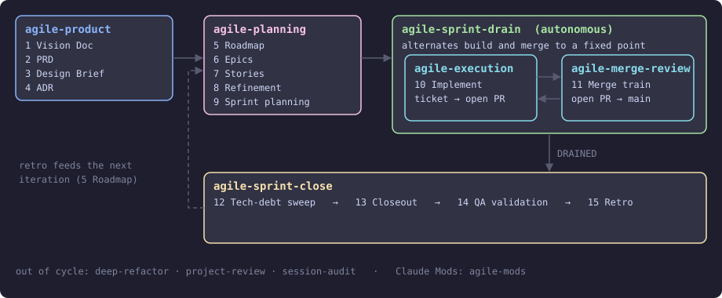
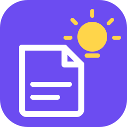
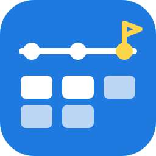
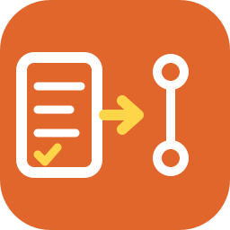
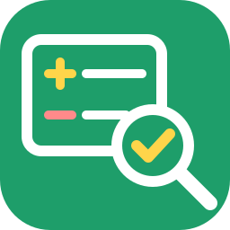
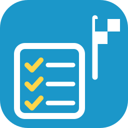
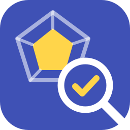
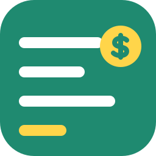

# agile-skills

[Claude Code](https://claude.ai/code) skills that run the whole agile cycle, from Vision Doc and PRD to a roadmap, then **autonomously build and self-review every Jira ticket into a PR**, merge them, and close the sprint.

Wired into **Confluence** and **Jira**. Install only the phases you run; each plugin loads only its own skills.



## Plugins

| Plugin | Phase | You get | Needs |
|---|---|---|---|
| <br>[**agile-product**](agile-product/README.md) | Discovery | Vision Doc, PRD, Design Brief / Specs UI, ADR | Atlassian MCP |
| <br>[**agile-planning**](agile-planning/README.md) | Planning | Roadmap (+ published Artifact), Epics, Stories, Refinement, Sprint Planning | Atlassian MCP |
| <br>[**agile-execution**](agile-execution/README.md) | Build, autonomous | Every ticket to an open, self-reviewed PR | Atlassian MCP, `gh` |
| <br>[**agile-merge-review**](agile-merge-review/README.md) | Merge | Every open PR rebased, reviewed, merged, closed out in Jira | `gh`, Atlassian MCP |
| <br>[**agile-sprint-drain**](agile-sprint-drain/README.md) | Drain, autonomous | Build and merge alternated until the sprint is done | `gh`, Atlassian MCP, the two above |
| <br>[**agile-sprint-close**](agile-sprint-close/README.md) | Close | Tech-debt sweep, closeout gate, QA sign-off, retro | `gh`, Atlassian MCP |
| <br>[**deep-refactor**](deep-refactor/README.md) | Cleanup, out of cycle | Codebase, test-suite and docs audits shipped as PR trains | `gh`, your tracker |
| <br>[**project-review**](project-review/README.md) | Assessment, out of cycle | Read-only, evidence-backed technical review report | nothing |
| <br>[**session-audit**](session-audit/README.md) | Cost audit, out of cycle | Spend per skill and subagent, before/after delta, ranked fixes | `gh` (optional) |
| <br>[**agile-mods**](agile-mods/README.md) | Visibility and enforcement | `/agile-board` console for the loop, guards on its rules, `/receipts` | Claude Code 2.1.287+, `gh` (Jira MCP optional) |

Each plugin README has its skills, triggers and setup.

## What the build loop does

`agile-execution` pulls the active sprint, walks tickets in Jira dependency order, and drives each to an open, self-reviewed PR with no mid-loop hand-holding. It tells you what it is doing as it goes: `▶ VC-123 — plan`, `✓ VC-123 → In Review`. `agile-sprint-drain` then alternates it with the merge train until the board is empty.

Skills keep a global numbering (`agile-1` … `agile-15`) across plugins. Invoke with `/<plugin>:<skill>`, for example `/agile-planning:agile-5-roadmap`, or say a trigger phrase.

## Cycle order

Each skill reads what the previous one wrote (Confluence pages, Jira issues) and picks up where it left off if re-run. Running a skill twice never duplicates content.

| Stage | Skills | Plugin |
|---|---|---|
| Discovery | 1 Vision Doc → 2 PRD → 3 Design Brief → 4 ADR | agile-product |
| Planning | 5 Roadmap → 6 Epics → 7 Stories → 8 Refinement → 9 Sprint Planning | agile-planning |
| Build | 10 Implement: validate, plan, code, PR, self-review, monitor | agile-execution |
| Merge | 11 Merge train: rebase, review, fix, fresh CI, merge, postmortem + Done | agile-merge-review |
| Drain | Alternates 10 and 11 to a fixed point | agile-sprint-drain |
| Close | 12 Tech-debt sweep → 13 Closeout → 14 QA validation → 15 Retro, back to 5 | agile-sprint-close |

The same code is reviewed by **three roles**,: the author's self-review ([implement-review](agile-execution/README.md)), an independent PR review ([merge-review-pr](agile-merge-review/README.md)), and a global sprint review ([sprint-closeout](agile-sprint-close/README.md)).

## Requirements

- [Claude Code](https://claude.ai/code) v2.1.128 or later (`agile-mods` needs 2.1.287)
- Atlassian MCP with Confluence and Jira, for every plugin except `deep-refactor`, `project-review`, `session-audit` and `agile-mods`
- GitHub CLI (`gh`) for `agile-execution`, `agile-merge-review`, `agile-sprint-drain`, `agile-sprint-close` and `deep-refactor`

## Install

```bash
/plugin marketplace add cedricfarinazzo/agile-skills
/plugin install agile-product@agile-skills        # install any subset
/plugin install agile-planning@agile-skills
/plugin install agile-execution@agile-skills
/plugin install agile-merge-review@agile-skills
/plugin install agile-sprint-close@agile-skills
/plugin install agile-sprint-drain@agile-skills   # needs execution + merge-review
/plugin install deep-refactor@agile-skills        # out of cycle
/plugin install project-review@agile-skills       # out of cycle
/plugin install session-audit@agile-skills        # out of cycle
/plugin install agile-mods@agile-skills           # console and guards
/reload-plugins
```

Common sets: planning + execution + merge-review for an active dev loop; product + planning for discovery only.

### Per-repo configuration

The dev-side plugins read project values (`cloudId`, status names, lint commands, board and branch settings) from the consumer repo's `CLAUDE.md/AGENTS.md`. See [execution](agile-execution/README.md#configuration) and [merge-review](agile-merge-review/README.md#configuration). All Confluence-using skills share one folder layout: [agile-planning ▸ Confluence structure](agile-planning/README.md#confluence-structure).

### Local development

```bash
git clone https://github.com/cedricfarinazzo/agile-skills
claude --plugin-dir ./agile-skills/agile-execution   # one plugin dir at a time
```

### Codex CLI

```bash
codex plugin marketplace add cedricfarinazzo/agile-skills
codex plugin add agile-product@agile-skills          # any plugin except agile-mods (Claude Code only)
```

Invoke skills as `$skill-name`. Codex runs every workflow inline: no plugin agents, `concurrency=0`, and every `dispatch` value is inline. Artifact publication is optional; Confluence stays the source of truth. Claude Code is the primary host and parity is best effort. See [compatibility](docs/CODEX_COMPATIBILITY.md) and [known parity gaps](docs/KNOWN_PARITY_GAPS.md).

### GitHub Copilot CLI

Skills follow the [Agent Skills](https://agentskills.io) open standard; copy the directories you want:

```bash
git clone https://github.com/cedricfarinazzo/agile-skills
cp -r agile-skills/{agile-product,agile-planning,agile-execution,agile-merge-review,agile-sprint-drain,agile-sprint-close,deep-refactor,project-review,session-audit}/skills/* ~/.copilot/skills/
```

This copies skills only. Plugin agents and bundled scripts (`agile-8`, `agile-13`, `session-audit`) are not copied, so run phases inline.

## License

MIT
