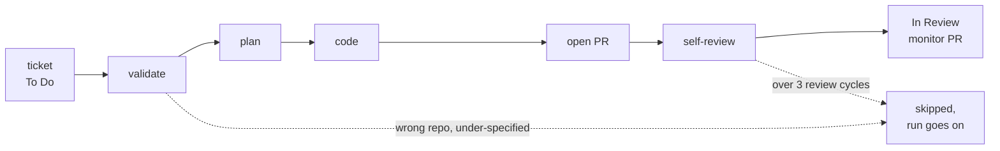

#  agile-execution

Turns a planned sprint into open, self-reviewed pull requests without you in the loop. It takes the active board's tickets in Jira dependency order and drives each one to an open PR.

Part of [agile-skills](../README.md). Needs the Atlassian MCP and `gh`.

## What you get

| Skill | What it does | Say |
|---|---|---|
| `agile-10-implement` | Builds every eligible ticket: validate, plan, code, PR, self-review, move to In Review, watch the PR | "implement the sprint", "work the sprint", "pick up tickets", "implement story PROJ-XXX", "start coding" |

Six `implement-*` sub-skills do the phases. They are `user-invocable: false`: hidden from the `/` menu, called by the orchestrator. Arguments: optional ticket keys (for example `PROJ-123`; default is the whole active sprint) and `concurrency=N` (default `1`).



You see progress as it runs: `▶ VC-123 — plan`, `✓ VC-123 → In Review`. The merge side is [agile-merge-review](../agile-merge-review/README.md); [agile-sprint-drain](../agile-sprint-drain/README.md) alternates the two.

## Install

```bash
/plugin marketplace add cedricfarinazzo/agile-skills
/plugin install agile-execution@agile-skills
/reload-plugins
```

Run `/agile-execution:agile-10-implement`. On Codex, run `$agile-10-implement`; phases run inline with `concurrency=0` because plugin agents are Claude Code only.

## Configuration

Read from the repo's `CLAUDE.md` or `AGENTS.md` under `## Skill configuration`.

| Key | Default | Use |
|---|---|---|
| `cloudId` | required | Atlassian site |
| `ticket-prefix-regex` | `[A-Z]+-\d+` | Ticket key pattern |
| `repo`, `repo-component-map` | from git `origin` | Repo-scope gate: tickets for another repo are skipped |
| `todo-`, `in-progress-`, `in-review-`, `done-`, `needs-info-`, `backlog-status-name` | Jira defaults; `backlog-status-name` is `Backlog`; `needs-info-status-name` unset leaves the ticket in `To Do` labelled `needs-info` | Status names, matched by substring, so localised names work |
| `board-id`, `board-type` | detected | Pin when detection is ambiguous |
| `story-points-field` | `customfield_10016` | Where points live |
| `base-branch`, `branch-prefix` | repo default, `feature/` | Branching |
| lint, unit, integration commands | looked up from the repo when absent | Per stack; sorted into stack-free and stack-bound tiers for concurrent builds |
| `max-build-concurrency` | `1` | Default for `concurrency=N` |

## What it asks you

Almost nothing. It decides reversible choices itself and flags them in the PR. It stops one ticket, and asks one question, only for a critical decision: irreversible or high blast radius, and not derivable from the ADR, PRD or Specs. The other tickets keep going. Details in [Autonomy](docs/autonomy.md).

## More

| Page | Covers |
|---|---|
| [Autonomy](docs/autonomy.md) | What it decides, what parks a ticket, the other exits |
| [Board and eligibility](docs/board.md) | Scrum vs Kanban, backlog never eligible, repo-scope gate, resuming |
| [Concurrency](docs/concurrency.md) | `concurrency=0/1/N`, test tiers, worktrees |
| [Reference](docs/reference.md) | Agents and models, receipts, CI waits, red-check rules, pushes and caps |

With [agile-mods](../agile-mods/README.md) installed, the push, fix-round and ticket-cap rules are enforced as guards.

## Where it fits

After [agile-planning](../agile-planning/README.md); produces the PRs that [agile-merge-review](../agile-merge-review/README.md) merges. Full cycle: [root README](../README.md#cycle-order).
