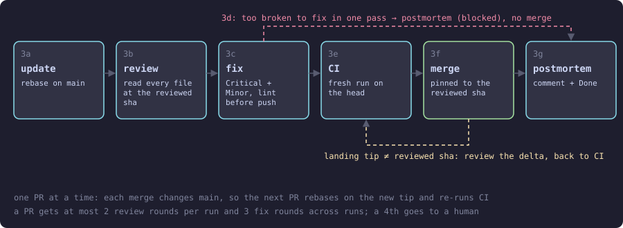

#  agile-merge-review

Clears the open-PR queue safely. Every PR that lands on `main` has been rebased, reviewed file by file against its Jira acceptance criteria, re-verified by a fresh CI run, merged, and closed out in Jira. 

Part of [agile-skills](../README.md). Needs `gh` and the Atlassian MCP.

## What you get

| Skill | What it does | Say |
|---|---|---|
| `agile-11-merge-train` | Takes every open PR in turn: rebase, review, fix, fresh CI, merge, Jira postmortem and Done | "merge train", "process all open PRs", `/merge-train` |

Four `merge-*` sub-skills do the steps. They are unnumbered and the train calls them. Each runs in its own scoped `agile-merge-review:*` agent (`agents/`) and returns a receipt the train checks.



One PR at a time: each merge changes `main`, so the next PR rebases on the new tip and re-runs CI. A PR too broken to fix in one pass is blocked, not merged, and the train moves on.

## Install

```bash
/plugin marketplace add cedricfarinazzo/agile-skills
/plugin install agile-merge-review@agile-skills
/reload-plugins
```

Run `/agile-merge-review:agile-11-merge-train`. On Codex, run `$agile-11-merge-train`; steps run inline with `concurrency=0` because plugin agents are Claude Code only.

## Configuration

Read from the repo's `CLAUDE.md/AGENTS.md`.

| Key | Use |
|---|---|
| `cloudId` | Required. Atlassian site |
| `ticket-prefix-regex` | Ticket key pattern; default `[A-Z]+-\d+` |
| `done-status-name`, `done-transition-id` | The Done status; the id is an optional fast path |
| lint commands | Per touched path family; run before every fix push |

## What it guarantees

- **Only reviewed code merges.** The merge asserts the landing head equals the sha a reviewer read in full. A fix pushed after review is reviewed again, as a delta.
- **CI is fresh.** Green on the rebased head, not "green yesterday".
- **Red checks need proof.** "Pre-existing" (or "unrelated", "environment") needs the same command run on the base branch.
- **Jira is closed out.** A postmortem comment and a Done transition, verified, even for a PR with zero findings.
- **It escalates to a person.** A PR past its fix rounds, or with an open Critical after the delta review, goes to a human instead of merging.

How each is enforced: [Reference](docs/reference.md). The sequence: [Per-PR sequence](docs/per-pr-sequence.md).

With [agile-mods](../agile-mods/README.md) installed, the merge, CI, review and push rules are enforced at the tool call.

## More

| Page | Covers |
|---|---|
| [Per-PR sequence](docs/per-pr-sequence.md) | Steps 3a to 3g, round budgets, order and stops, agents |
| [Reference](docs/reference.md) | Receipts, the reviewed-sha gate, base-branch proof, review checks |

## Where it fits

After [agile-execution](../agile-execution/README.md) opens the PRs; before [agile-sprint-close](../agile-sprint-close/README.md). This is the independent second of three review layers: author self-review, this, then the global [sprint closeout](../agile-sprint-close/README.md). Formerly `dev-skills`. Full cycle: [root README](../README.md#cycle-order).
