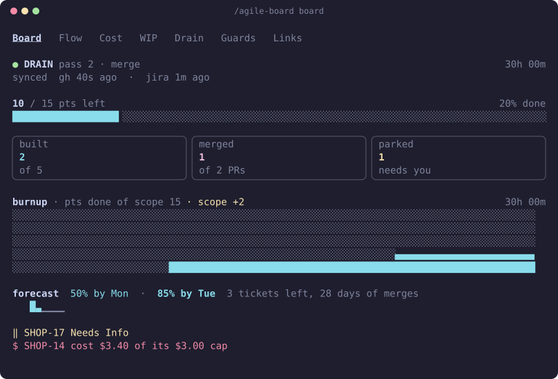
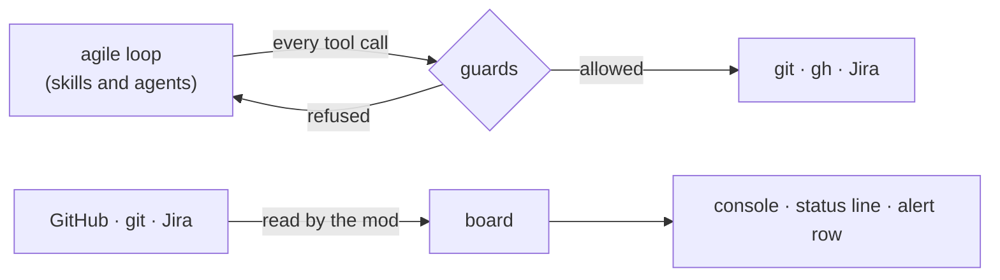
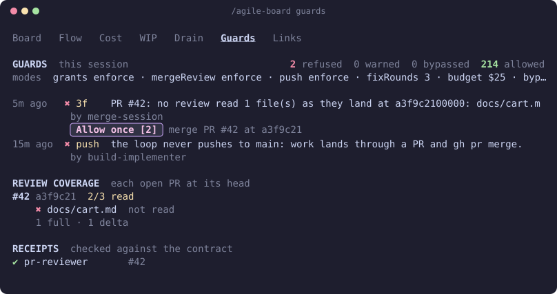

# agile-mods

See what the agile loop is doing, and stop it from cutting corners.

agile-mods is a set of [Claude Mods](https://code.claude.com/docs/en/plugins/mods/overview) for the agile-skills loop (`agile-10-implement`, `agile-11-merge-train`, `agile-sprint-drain`). It adds a live console to Claude Code, and guards that check the loop's work against GitHub, git and Jira, not against what the model says.



## What you get

| | What it does | Page |
|---|---|---|
| **Console** | A status line, an alert row when something needs you, and a six-tab pane: board, flow, WIP, drain, guards, links | [Console](docs/console.md) |
| **Guards** | Refuse a merge nobody reviewed, a push to `main`, a PR that keeps failing review, build work past your budget | [Guards](docs/guards.md) |
| **Receipts** | Flag an agent whose report breaks the contract | [Receipts](docs/receipts.md) |
| **Retro data** | Counts for the sprint retro, recorded as the loop runs | [Retro data](docs/retro.md) |



## Install

```text
/plugin marketplace add cedricfarinazzo/agile-skills
/plugin install agile-mods@agile-skills
```

Needs Claude Code 2.1.287 or later (Desktop app 2.1.286). Mods are on by default. To turn them off, disable the plugin in `/plugin`, start with `--safe-mode`, or set `disableAllHooks` in `~/.claude/settings.json`.

Before the first run:

1. Log `gh` in for the repo (`gh auth status`).
2. For the Jira side, name `cloudId` under `## Skill configuration` in the repo's `CLAUDE.md` or `AGENTS.md` (the loop already needs it), and allow the read-only `mcp__<server>__searchJiraIssuesUsingJql` in `/permissions`. Without either, the board shows GitHub data and says what is missing.
3. Run `/agile-board` to open the console. It also opens by itself when `agile-sprint-drain` starts, in a terminal of 144 columns or more.

## When a guard stops the loop

A guard refuses the call and tells the model why and what to do instead, so most refusals fix themselves. When one cannot (a review that keeps missing a file, a PR past its fix rounds, the budget), the loop reports the PR or ticket as blocked and moves on.

1. Read the toast, or open `/agile-board guards`.
2. Fix the cause, or press **Allow once** under the refusal to let that one merge, fix round or ticket through.
3. Tell the loop to retry.



## Settings

Set in `/plugin configure agile-mods@agile-skills`. They apply from the next session.

| Setting | Default | What it does |
|---|---|---|
| `autoOpen` | `true` | Open the console when a drain starts |
| `budgetUsd` | `0` (none) | Stop new build work once a loop run has spent this much; open PRs still merge |
| `guardMergeReview` | `enforce` | A merge needs every changed file read by a reviewer |
| `guardMergeCi` | `enforce` | A merge needs green CI on the head it merges |
| `guardMergePin` | `enforce` | A merge must pin the reviewed head |
| `guardPush` | `enforce` | No push to `main`, no force push without a lease. `enforce` or `warn` only |
| `guardGrants` | `enforce` | Each agent keeps to its tools (reviewers never edit or post) |
| `guardSideDoor` | `enforce` | No way around the other guards (API branch writes, git aliases) |
| `fixRounds` | `3` | Fix rounds a PR gets after review before a person decides; `0` is no cap |
| `allowBypass` | `true` | Show the **Allow once** button |

`enforce` refuses the call, `warn` lets it through and logs it on the Guards tab, `off` skips the check. A repo can set the same keys in its `CLAUDE.md` or `AGENTS.md`, but only to make them stricter. More in [Guards: settings](docs/guards.md#settings).

## Privacy

The mod runs only `gh` and `git`, only to read, and calls only the Jira search tool you already allowed. It sends nothing anywhere else, keeps its state on your machine, and reads no credentials. The full list of commands, calls and reads is in the [reference](docs/reference.md#what-the-mod-reads-runs-and-sends).

## Develop

```bash
cd agile-mods && bun test        # unit tests: tests/unit
claude plugin test ./agile-mods  # engine tests: tests/engine
claude plugin validate ./agile-mods
bun docs/img/generate.ts         # redraw the pictures after a view changes
claude --plugin-dir ./agile-mods
```

The code layout and the engine's limits are in the [reference](docs/reference.md#code-layout).
