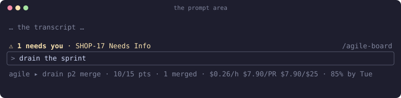
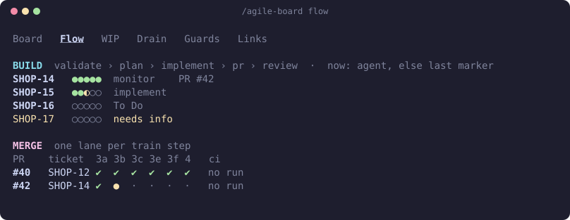
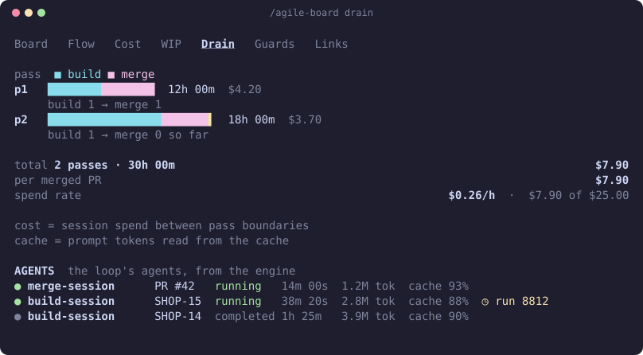

# Agile console

[← agile-mods](../README.md)

Where the loop is, whether it is stuck, what it costs and when it will be done, without reading the transcript.

## Three places



- **Status line**, always there while a loop has run: stage, work left, merges, spend rate, budget, the date by which 85% of forecasts finish, and `⚑ n bypass` while a bypass is open.
- **Alert row** above the prompt, only when something needs you: a parked ticket, work looping on the same step, a spent budget, a PR open far longer than usual, a drop in prompt-cache hits, or the drain ending `STUCK` (red) or `DRAINED` (green).
- **The console pane**, opened with `/agile-board`.

## The pane

```text
/agile-board [board | flow | wip | drain | guards | links]   open at a tab
/agile-board show | hide                                      status line and alert row on or off
/agile-board retro                                            print the retro counts
/agile-board allow [id]                                       list refusals you can bypass, or allow one
/agile-board reset                                            clear the board, guard log, receipts, retro counts and reviews
```

`allow <id>` and `reset` work only when you run them yourself, at the prompt or from your phone.

The pane docks beside the transcript in a terminal of 110 columns or more, and sits above the prompt otherwise. Keys `1` to `6` switch tabs while the pane has focus; `Esc` closes it.

| Tab | Shows |
|---|---|
| **1 Board** | Work left, built / merged / parked, the burnup, the forecast, and what needs you |
| **2 Flow** | Each open ticket's build phase now, and each PR's merge-train step and CI |
| **3 WIP** | How long each PR and ticket has been open against the repo's usual, and PRs touching the same files |
| **4 Drain** | Each drain pass: build and merge time, what it moved, its cost and cache hit rate; the loop's agents |
| **5 Guards** | Guard modes, refusals with their **Allow once** button, review coverage per PR, agent receipts. See [Guards](guards.md) |
| **6 Links** | Each ticket's Jira page and each PR |





## Reading the numbers

- **Burnup.** Work done (cyan) under total scope (grey). A ticket added mid-sprint raises the scope instead of hiding in a flat line. Story points once every ticket has them, ticket counts until then.
- **Forecast.** 1000 simulated futures drawn from the repo's last 30 days of merges. "85% by Tue" means 85% of them finished by Tuesday. It waits for 10 days of merges and assumes the next weeks look like the last month.
- **Build phase.** The dot being drawn `◐` is the step running now, bold when an agent is on it and plain when it is only the step after the last Jira marker. Finished steps are `●`. After `review` a ticket reads `handoff`, then `monitor`. A `?` after the name means only an old marker says so. The rules are in the [reference](reference.md#the-board).
- **Aging.** A PR past the repo's 85th percentile of time open goes to the alert row.
- **Overlap.** Two open PRs on the same file: merge the disjoint ones first, since the second of the pair will need a rebase.
- **Cost.** Each drain pass shows what that pass spent. `$/h` and `$/PR` count from the start of the run, which only a new session or `/agile-board reset` restarts.
- **Cache.** The share of prompt tokens read from the prompt cache, per stage. A long CI wait or a changed prompt makes it drop, and every request costs more.

## Where the data comes from

The board reads GitHub with `gh` and Jira with the session's Atlassian tool, and refreshes a few seconds after the loop pushes, merges, comments or dispatches, when the loop goes idle, when you open the pane, and every 5 minutes while a loop runs. It never takes the model's word for what happened. A new `agile-sprint-drain` starts a fresh board; resuming a drain keeps it.

The exact queries, refresh limits and drain rules are in the [reference](reference.md#the-board).

## Limits

- It draws in the terminal and the Desktop Code tab. Elsewhere (VS Code chat, `claude -p`) the guards still run and nothing draws.
- A pane that opens by itself waits for a 144-column terminal; `/agile-board` opens it at any width.
- Large sprints fill in over a few minutes: Jira is read 50 tickets a page, and phase markers a few tickets per refresh.
