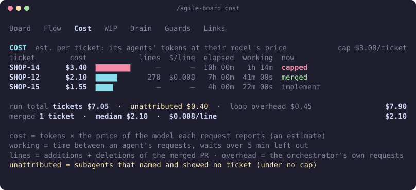
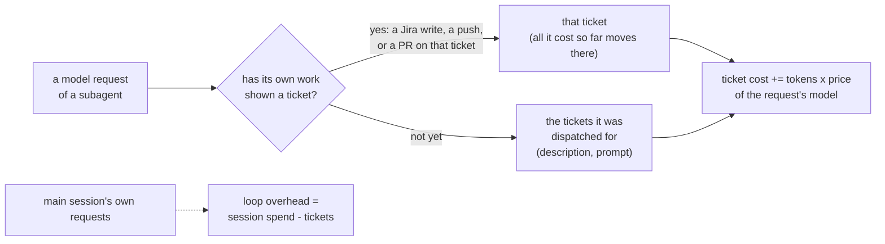

# Agile console

[← agile-mods](../README.md)

Where the loop is, whether it is stuck, what it costs and when it will be done, without reading the transcript.

## Three places


- **Status line**, always there while a loop has run: stage, work left, merges, spend rate, the ticket cap and how many are over it, the date by which 85% of forecasts finish, and `⚑ n bypass` while a bypass is open.
- **Alert row** above the prompt, only when something needs you: a parked ticket, work looping on the same step, a ticket past its cost cap, a PR open far longer than usual, a drop in prompt-cache hits, or the drain ending `STUCK` (red) or `DRAINED` (green).
- **The console pane**, opened with `/agile-board`.

## The pane

```text
/agile-board [board | flow | cost | wip | drain | guards | links]   open at a tab
/agile-board show | hide                                      status line and alert row on or off
/agile-board retro                                            print the retro counts
/agile-board allow [id]                                       list refusals you can bypass, or allow one
/agile-board reset                                            clear the board, guard log, receipts, retro counts and reviews
```

`allow <id>` and `reset` work only when you run them yourself, at the prompt or from your phone.

The pane docks beside the transcript in a terminal of 110 columns or more, and sits above the prompt otherwise. Keys `1` to `7` switch tabs while the pane has focus; `Esc` closes it.

| Tab | Shows |
|---|---|
| **1 Board** | Work left, built / merged / parked, the burnup, the forecast, and what needs you |
| **2 Flow** | Each open ticket's build phase now, and each PR's merge-train step and CI |
| **3 Cost** | What each ticket cost: dollars, changed lines, cost per line, elapsed and working time, and the median of the merged ones |
| **4 WIP** | How long each PR and ticket has been open against the repo's usual, and PRs touching the same files |
| **5 Drain** | Each drain pass: build and merge time, what it moved, its cost and cache hit rate; the loop's agents |
| **6 Guards** | Guard modes, refusals with their **Allow once** button, review coverage per PR, agent receipts. See [Guards](guards.md) |
| **7 Links** | Each ticket's Jira page and each PR |





## Reading the numbers

- **Burnup.** Work done (cyan) under total scope (grey). A ticket added mid-sprint raises the scope instead of hiding in a flat line. Story points once every ticket has them, ticket counts until then.
- **Forecast.** 1000 simulated futures drawn from the repo's last 30 days of merges. "85% by Tue" means 85% of them finished by Tuesday. It waits for 10 days of merges and assumes the next weeks look like the last month.
- **Build phase.** The dot being drawn `◐` is the step running now, bold when an agent is on it and plain when it is only the step after the last Jira marker. Finished steps are `●`. After `review` a ticket reads `handoff`, then `monitor`. A `?` after the name means only a marker posted over 10 minutes ago says so, or the marker is one this version does not know. The rules are in the [reference](reference.md#the-board).
- **Aging.** A PR past the repo's 85th percentile of time open goes to the alert row.
- **Overlap.** Two open PRs on the same file: merge the disjoint ones first, since the second of the pair will need a rebase.
- **Cost, per pass.** Each drain pass on the Drain tab shows what that pass spent. `$/h` and `$/PR` count from the start of the run, which only a new session or `/agile-board reset` restarts.
- **Cost, per ticket.** The Cost tab adds up what the agents that worked a ticket spent: each request's tokens at the price of its model. The orchestrator's own session is not a ticket, so it shows as **loop overhead**: the session's spend minus the tickets. Dollars are an estimate; the run total ties to the session's own figure.
  - **lines** are the additions and deletions of the merged PR; **$/line** divides the ticket's cost by them.
  - **elapsed** runs from when Jira moved the ticket in progress to the PR's merge; **working** is the time between an agent's requests, with waits over 5 minutes left out, so a CI wait is not counted.
  - **median** and **$/line** at the foot count merged tickets only, so half-built work doesn't pull them down. The **run total** counts everything.
  - A bar in amber is a ticket costing over twice the merged median.
  - A `⚠` line means the tickets add up to more than the session spent: the price table is above what you pay.
- **Cache.** The share of prompt tokens read from the prompt cache, per stage. A long CI wait or a changed prompt makes it drop, and every request costs more.

## How a ticket's cost is counted



What an agent was told it works is only a claim. Its own calls that change something for a ticket (a Jira comment or transition, a push or checkout of its branch, a PR create or merge) show what it works, and outrank the claim: naming another ticket in a prompt moves no cost off the ticket the work is on, and the first call that contradicts a claim moves everything the agent has cost so far, with a warning on the Guards tab. A session agent working its tickets in turn follows the one each of those calls names; the request that made the call counts for it. Reads name a ticket without working on it, so they show nothing. An agent dispatched for several tickets shares its cost evenly among them until its work shows which. Requests with nothing to attach to count as overhead.

## Where the data comes from

The board reads GitHub with `gh` and Jira with the session's Atlassian tool, and refreshes a few seconds after the loop pushes, merges, comments or dispatches, when the loop goes idle, when you open the pane, and every 5 minutes while a loop runs. It never takes the model's word for what happened. A new `agile-sprint-drain` starts a fresh board; resuming a drain keeps it.

The exact queries, refresh limits and drain rules are in the [reference](reference.md#the-board).

## Limits

- It draws in the terminal and the Desktop Code tab. Elsewhere (VS Code chat, `claude -p`) the guards still run and nothing draws.
- A pane that opens by itself waits for a 144-column terminal; `/agile-board` opens it at any width.
- Large sprints fill in over a few minutes: Jira is read 50 tickets a page, and phase markers a few tickets per refresh.
