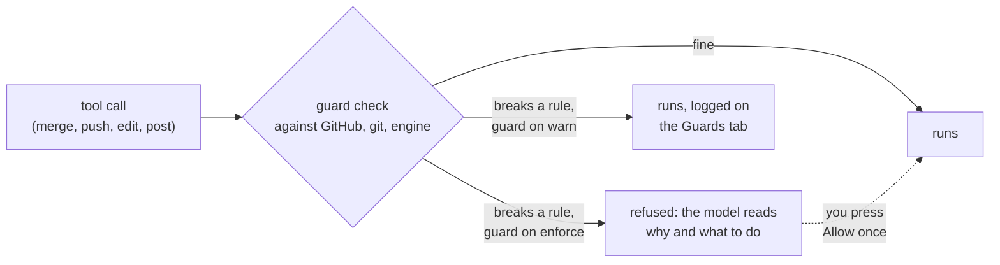
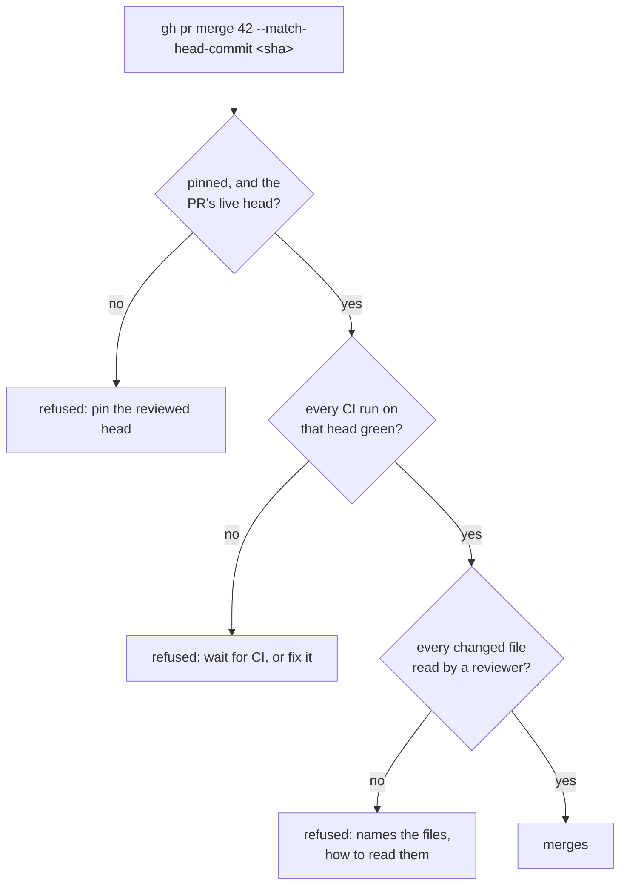
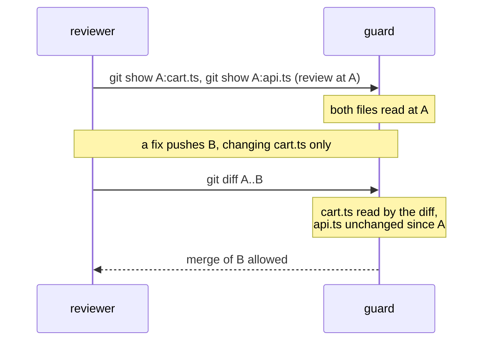
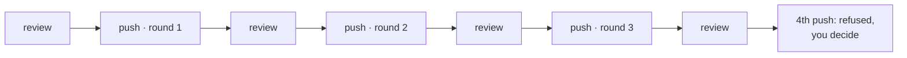
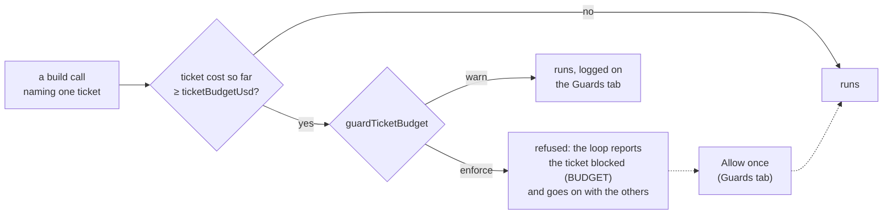
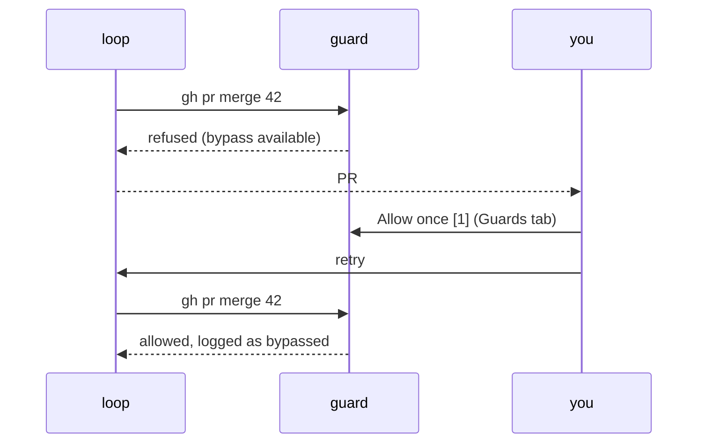

# Guards

[← agile-mods](../README.md)

The skills tell the loop what not to do: never merge code nobody reviewed, never push to `main`, stop fixing a PR that won't converge. Guards make those rules hold. Each one checks a tool call before it runs, against GitHub, git and the engine, and refuses it when it breaks a rule.

A refusal comes back to the model as the tool's error, saying what was wrong and what to do instead, so the loop usually corrects itself. When it can't, the loop marks that PR or ticket blocked and goes on with the rest. You can then fix the cause, or allow that one call once.



## The guards

| Guard | Stops | Setting |
|---|---|---|
| **Merge: review** | Merging a PR with a file no reviewer read as it lands | `guardMergeReview` |
| **Merge: CI** | Merging on CI that is red, running or missing | `guardMergeCi` |
| **Merge: pin** | Merging a head other than the one reviewed | `guardMergePin` |
| **Fix rounds** | A fourth round of fixes on a PR that keeps failing review | `fixRounds` |
| **Push** | Pushing to `main`/`master`, or force pushing without a lease | `guardPush` |
| **Ticket cap** | Starting new build work on a ticket whose agents already cost `ticketBudgetUsd` (its open PR and the other tickets go on) | `guardTicketBudget`, `ticketBudgetUsd` |
| **Tool grants** | A reviewer editing files or posting; the postmortem linking issues | `guardGrants` |
| **Side doors** | Getting around the others: branch writes through the GitHub API or MCP, git aliases, config overrides | `guardSideDoor` |

The guards only watch the loop. They turn on when `agile-10-implement`, `agile-11-merge-train` or `agile-sprint-drain` starts, or inside one of their agents, and stay on until `/agile-board reset` or a new session.

## Merging

Before `gh pr merge`, the guard reads GitHub itself:



### What counts as reviewing a file

The reviewer has to actually read each changed file at the commit that will land. The guard looks at the commands it ran, not at its report:

| Counts | Does not count |
|---|---|
| `git show 3f1c0a9e:src/cart.ts` | `cat src/cart.ts` (the working tree may be another branch) |
| `git show 3f1c0a9e:docs/guide.md \| sed -n 1,212p`, then the next ranges to the end | `git show …:docs/guide.md \| head -50` alone (half the file) |
| `S=3f1c0a9e; git show $S:src/cart.ts` | Output cut off at the 30,000-character limit |
| `git show '3f1c0a9e:app/(shop)/$id.tsx'` (special characters, single-quoted) | `cd src && git show 3f1c0a9e:./cart.ts` (write paths from the repo root) |
| After a fix: `git diff 3f1c0a9e..b2d4e6f1` | `git diff --stat 3f1c0a9e..b2d4e6f1` (no lines shown) |

The guard also compares the output with git's own copy of the file or diff. A command whose output went somewhere else, or was rewritten on the way (an external diff tool, a `git` shell function), counts for nothing.

**Who can review.** Reads count from `pr-reviewer`, the drain's `merge-session`, and the main loop while it runs the merge train. The build side never counts, so code is never reviewed by its own author.

**After a fix, only the fix is reread.** A file read before the fix still counts if the fix didn't touch it. For a file the fix changed, reading the diff since the reviewed commit is enough.



**Told right away.** When a reviewer's read does not count, the same command's result says why and what to run instead. For a file too large to read in one go, it gives the exact chunks to read:

```text
agile-mods: not counted for review: the output passed 30,000 characters and was cut, so nothing in it
counted: read docs/guide.md as git show 3f1c0a9e…:docs/guide.md | sed -n 1,212p · 213,398p · 399,520p.
```

The Guards tab shows, for each open PR, how many files count as read and which don't.

## Fix rounds

A round is one go of fixing after a review: it starts with a push onto a commit a reviewer has read. More pushes before the next review are the same round. So are fresh agents resuming after a CI wait.



These never count as a round:

- updating the branch from `main` (`agile-11-merge-train` 3a);
- a push that puts back a commit already reviewed, sent in its own command after the commit (for example undoing a bad change);
- deleting a branch.

Run mutation checks (breaking the code on purpose to prove a test fails) locally. Never push them to the PR.

## Ticket cap

With `ticketBudgetUsd` set, once the agents that worked a ticket have cost that much, new build work **on that ticket** is refused:

- running `implement-*` for it;
- opening its PR;
- dispatching a build agent for it.



The cost is the [Cost tab](console.md)'s estimate: the ticket's agents' tokens at their model's price, counted from the start of the run. Its open PR still merges, the other tickets go on, and a drain that is left with only capped tickets ends `STUCK`, naming each with its cost. A call that names no single ticket, or several, is not held to the cap. The ticket's work can overshoot by the phase already running, since a guard acts on the next call.

## Bypass

Some refusals can be allowed once, by you. The refusal tells the loop to report the PR or ticket as blocked and wait, not to ask you to run the command. On the Guards tab, the refusal has an **Allow once** button:




| Refused | Allow once lets through |
|---|---|
| A merge gate on PR #42 | One merge of PR #42 at the head it was refused at, within 30 minutes |
| The fix-round cap on PR #42 | One more fix round on PR #42, within 30 minutes |
| A ticket's cost cap | Build work for that ticket, until it is done, parked or merged |

Only you can grant one: the pane button, or `/agile-board allow <id>` typed at the prompt (or sent from your phone). The model, a skill or another plugin running the same command gets nothing. `/agile-board allow` lists what can be allowed. An allowed merge still has to pin the head you allowed, so nothing pushed after your click slips in.

The push, grant and side-door guards have no bypass. Change their setting instead. An open bypass shows as `⚑ 1 bypass` in the status line, and each call it lets through is logged on the Guards tab and counted in the retro data. Nothing about it leaves your machine.

## Settings

Set in `/plugin configure agile-mods@agile-skills`; they apply from the next session.

| Mode | The guard |
|---|---|
| `enforce` (default) | refuses the call |
| `warn` | lets it through, with a toast and a `warned` entry on the Guards tab; the model is not told |
| `off` | does not check, and reads nothing |

`guardPush` has no `off`: a push to `main` cannot be undone. `fixRounds` is a number (`0` turns the cap off), `ticketBudgetUsd` an amount per ticket (`0` is none; `guardTicketBudget` sets what happens at it), and `allowBypass` shows or hides the button. The run-wide `budgetUsd` is gone: a stored value is ignored and the Guards tab says so once.

**Per repo.** A repo's `CLAUDE.md` or `AGENTS.md` can set the same keys, but only to tighten them. The loop can edit those files, so a looser value there is ignored and flagged on the Guards tab.

```markdown
## Skill configuration
- guardMergeReview: enforce
- fixRounds: 2
- ticketBudgetUsd: 10
- allowBypass: false
```

## Refusals you may see

```text
agile-mods: PR #42: no review read 1 file(s) as they land at 3f1c0a9e2b7d: docs/guide.md. …
agile-mods: PR #42: CI on 3f1c0a9e2b7d has not finished (e2e in_progress). Wait for it (3e), then merge.
agile-mods: pin the reviewed head: gh pr merge 42 --squash --match-head-commit <reviewed sha> …
agile-mods: PR #42: 3 fix rounds already pushed after a review (onto 1a2b3c4, 5d6e7f8, 9a0b1c2). …
agile-mods: the loop never pushes to main: work lands through a PR and gh pr merge.
agile-mods: ticket budget: SHOP-15 cost an estimated $10.20 of its $10.00 cap (agile-mods ticketBudgetUsd). …
agile-mods: budget: the loop spent $20.40 of its $20.00 budget (agile-mods budgetUsd). …
agile-mods: pr-reviewer reviews and never edits files: report the finding instead.
```

When GitHub doesn't answer, a merge is refused rather than let through unchecked, and the loop retries. The exact rules for each guard are in the [reference](reference.md#guards).
