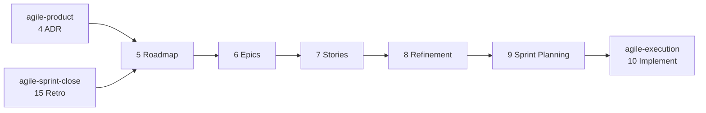

#  agile-planning

Planning: turns the approved product and architecture documents into a Roadmap, Jira Epics and Stories, a refined backlog and a launched sprint.

Part of [agile-skills](../README.md). Needs the Atlassian MCP (Confluence and Jira).

## What you get

| # | Skill | Produces | Say |
|---|---|---|---|
| 5 | `agile-5-roadmap` | Roadmap index, MVP and Iteration pages, Decision Log, Parking Lot, a published Artifact view; RESTRUCTURE migrates a drifted tree without losing information | "create roadmap", "define MVP", "plan iteration", "restructure roadmap", "fix confluence structure" |
| 6 | `agile-6-create-epics` | Epics in Jira, linked back to the Roadmap, with their Jira links added to the MVP or Iteration page's Epics table | "create epics", "set up Jira for MVP" |
| 7 | `agile-7-create-stories` | User Stories in Jira under each Epic | "write stories", "create user stories", "break down epic" |
| 8 | `agile-8-refinement` | Points, ACs and DoD; `refined` / `not-ready` labels | "refine stories", "estimate", "backlog refinement" |
| 9 | `agile-9-sprint-planning` | A Jira sprint planned and populated, capacity-fit and dependency-ordered; starting it in Jira is yours | "plan sprint", "start sprint", "sprint planning" |



Refinement is the gate: only `refined` Stories enter a sprint; `not-ready` ones are listed and excluded. Sprint planning enforces a capacity buffer, dependency order and a testable sprint goal. Every skill is read-before-write, idempotent and resumable.

## Install

```bash
/plugin marketplace add cedricfarinazzo/agile-skills
/plugin install agile-planning@agile-skills
/reload-plugins
```

Run a skill as `/agile-planning:<skill>`. On Codex, run `codex plugin add agile-planning@agile-skills` and invoke `$<skill-name>`. Artifact publication is optional; record its absence and keep Confluence as the complete result. See the [compatibility guide](../docs/CODEX_COMPATIBILITY.md). Configuration is read from `CLAUDE.md/AGENTS.md`.

## Roadmap modes and the sprint deep-dive

`agile-5-roadmap` runs in INIT mode (first roadmap), ITERATION mode (next iteration after a retro) or RESTRUCTURE mode. On request it also runs a per-sprint deep-dive: a sprint explainer artifact and an ADR-decision interview, whose answers become `D###` entries in the Decision Log, closed by an ADR and PRD sync.

## The planning pages

The Roadmap is an **index**: status line, guiding principle, iterations table, one progress rollup, a link to the Parking Lot, next step. Each `MVP` / `Iteration N` page holds the iteration (goal and its history, success criteria, epics, a sprints rollup, scope changes, risks); each sprint has its own `Sprint N` page under it (properties, goal, scope, decision ids, backlog, build order, success criteria, risks, conclusion). Decision text lives once, in the Decision Log. Every page has fixed `##` headings, keeps history only in `## Change history`, and has a size budget; the templates are in `skills/agile-5-roadmap/references/page-templates.md`.

| Writer | Writes |
|---|---|
| `agile-5-roadmap` | Roadmap index, Iteration pages, Decision Log entries, Parking Lot |
| `agile-9-sprint-planning` | The Sprint page; its row in the Iteration page's `## Sprints` and the Roadmap's `## Progress` |
| `agile-8-refinement` | The Sprint page's `## Backlog`, never the Iteration page or the index |
| `agile-15-retro` | Closes the Sprint page and both rollup rows; Working Agreements and Debt Register rows |

**RESTRUCTURE** fixes a tree that drifted (changelogs in status lines, one fact in many places, sprint sections inside giant pages, decisions under several id schemes). It reads every page in full, maps each block to its one home, shows you the plan and the contradictions to decide, archives the old bodies in `Extras`, rewrites the pages, then checks that every ticket key, decision id, link, number and date from the old pages is still present. Any skill that finds a drifted page proposes it.

## The Roadmap Artifact

The Roadmap index is also published as a Claude Code Artifact: a private, shareable page for stakeholders without a Confluence seat, with the progress rollup as a velocity chart.

Confluence stays the source of truth; the artifact is regenerated from it. Its identity is a `📊 Live roadmap:` line on the Roadmap page holding the URL. Every refresher reads that URL and republishes to it, so the link stakeholders hold keeps working.

| Skill | Artifact action |
|---|---|
| `agile-5-roadmap` | Publishes when the Roadmap has no `📊 Live roadmap:` line, otherwise refreshes; writes the URL back on first publish |
| `agile-9-sprint-planning` | Refreshes after the sprint rollup row lands; publishes if the line is absent |
| `agile-15-retro` | Refreshes at sprint close, with delivered-vs-committed numbers; publishes if the line is absent |

The page is self-contained (a strict CSP blocks every external host), theme-aware and responsive, with a stable `🗺️` favicon across redeploys. Without the Artifact tool the step is skipped and noted.

## Confluence structure

Canonical folder layout, identical across every agile-skills plugin (embedded verbatim in each Confluence-using skill):

```
📁 [Project Name]                         (root — agile-1)
├── 📄 Vision Doc — [Project]             (agile-1)
├── 📄 PRD — [Project]                    (agile-2)
├── 📄 Design Brief — [Project]           (agile-3 BRIEF)
├── 📄 Specs UI — [Project]               (agile-3 INTEGRATE)
├── 📄 ADR — [Project]                    (agile-4; current architecture state)
├── 📄 Decision Log — [Project]           (agile-5; register, one row per decision)
│   └── 📄 Decisions D001–D099 — [Project] (full entries by ID range: D100–D199, …)
├── 📄 Working Agreements — [Project]     (agile-5 creates · agile-15 writes; rules in force: process, planning, operator, ops)
├── 📄 Roadmap — [Project]                (agile-5 — INDEX only)
│   ├── 📄 Parking Lot — [Project]        (agile-5; unscheduled and rejected ideas)
│   ├── 📄 MVP — [Project]                (agile-5; an iteration page)
│   │   └── 📄 Sprint 1 — [Project]       (agile-9 plans · agile-8 backlog · agile-15 closes)
│   └── 📄 Iteration N — [Project]        (agile-5 ITERATION)
│       └── 📄 Sprint N — [Project]
├── 📁 Retrospectives — [Project]         (folder, agile-15; one Retro page per sprint)
├── 📁 Closeouts — [Project]              (folder, agile-13; sibling of Retrospectives, never inside it)
└── 📁 Extras — [Project]                 (folder; Debt Register (agile-15) + every page this tree does not name)
```

Every Confluence-using skill embeds this tree with the rules that go with it: where each page goes, the fixed `##` headings of every page type, one home per fact, size budgets, and what to do with a drifted page. Read them in [`skills/agile-5-roadmap/SKILL.md`](skills/agile-5-roadmap/SKILL.md#confluence-structure-canonical--identical-across-all-agile-skills); the field-level templates are in [`references/page-templates.md`](skills/agile-5-roadmap/references/page-templates.md).

## Bundled tool: shared-file collision audit

`agile-8-refinement` bundles `scripts/sprint-shared-file-audit.sh`. It surfaces file overlap across Stories so blocking Jira links are added at refinement instead of rediscovered as merge conflicts. Invoke it through the plugin root, since a bare relative path does not resolve when installed:

```bash
"${CLAUDE_PLUGIN_ROOT}/skills/agile-8-refinement/scripts/sprint-shared-file-audit.sh" --text-dir <scratch> ABC-28 ABC-30 ABC-39
```

Usage: `skills/agile-8-refinement/docs/sprint-shared-file-audit.md`.

## Where it fits

After [agile-product](../agile-product/README.md), before [agile-execution](../agile-execution/README.md). Full cycle: [root README](../README.md#cycle-order).
