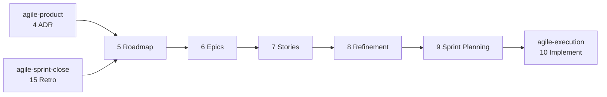

#  agile-planning

Planning: turns the approved product and architecture documents into a Roadmap, Jira Epics and Stories, a refined backlog and a launched sprint.

Part of [agile-skills](../README.md). Needs the Atlassian MCP (Confluence and Jira).

## What you get

| # | Skill | Produces | Say |
|---|---|---|---|
| 5 | `agile-5-roadmap` | Roadmap index, MVP and Iteration pages, Decision Log, Parking Lot, a published Artifact view; RESTRUCTURE migrates a drifted tree without losing information | "create roadmap", "define MVP", "plan iteration", "restructure roadmap", "fix confluence structure" |
| 6 | `agile-6-create-epics` | Epics in Jira, linked back to the Roadmap, with their Jira links added to the MVP or Iteration page's Epics table | "create epics", "set up Jira for MVP" |
| 7 | `agile-7-create-stories` | User Stories in Jira under each Epic | "write stories", "create user stories", "break down epic" |
| 8 | `agile-8-refinement` | Points, ACs and DoD; `refined` / `not-ready` labels | "refine stories", "estimate", "backlog refinement" |
| 9 | `agile-9-sprint-planning` | A Jira sprint planned and populated, capacity-fit and dependency-ordered; starting it in Jira is yours | "plan sprint", "start sprint", "sprint planning" |



Refinement is the gate: only `refined` Stories enter a sprint; `not-ready` ones are listed and excluded. Sprint planning enforces a capacity buffer, dependency order and a testable sprint goal. Every skill is read-before-write, idempotent and resumable.

## Install

```bash
/plugin marketplace add cedricfarinazzo/agile-skills
/plugin install agile-planning@agile-skills
/reload-plugins
```

Run a skill as `/agile-planning:<skill>`. On Codex, run `codex plugin add agile-planning@agile-skills` and invoke `$<skill-name>`. Artifact publication is optional; record its absence and keep Confluence as the complete result. See the [compatibility guide](../docs/CODEX_COMPATIBILITY.md). Configuration is read from `CLAUDE.md/AGENTS.md`.

## Roadmap modes and the sprint deep-dive

`agile-5-roadmap` runs in INIT mode (first roadmap), ITERATION mode (next iteration after a retro) or RESTRUCTURE mode. On request it also runs a per-sprint deep-dive: a sprint explainer artifact and an ADR-decision interview, whose answers become `D###` entries in the Decision Log, closed by an ADR and PRD sync.

## The planning pages

The Roadmap is an **index**: status line, guiding principle, iterations table, one progress rollup, a link to the Parking Lot, next step. Each `MVP` / `Iteration N` page holds the iteration (goal and its history, success criteria, epics, a sprints rollup, scope changes, risks); each sprint has its own `Sprint N` page under it (properties, goal, scope, decision ids, backlog, build order, success criteria, risks, conclusion). Decision text lives once, in the Decision Log. Every page has fixed `##` headings, keeps history only in `## Change history`, and has a size budget; the templates are in `skills/agile-5-roadmap/references/page-templates.md`.

| Writer | Writes |
|---|---|
| `agile-5-roadmap` | Roadmap index, Iteration pages, Decision Log entries, Parking Lot |
| `agile-9-sprint-planning` | The Sprint page; its row in the Iteration page's `## Sprints` and the Roadmap's `## Progress` |
| `agile-8-refinement` | The Sprint page's `## Backlog`, never the Iteration page or the index |
| `agile-15-retro` | Closes the Sprint page and both rollup rows; Working Agreements and Debt Register rows |

**RESTRUCTURE** fixes a tree that drifted (changelogs in status lines, one fact in many places, sprint sections inside giant pages, decisions under several id schemes). It reads every page in full, maps each block to its one home, shows you the plan and the contradictions to decide, archives the old bodies in `Extras`, rewrites the pages, then checks that every ticket key, decision id, link, number and date from the old pages is still present. Any skill that finds a drifted page proposes it.

## The Roadmap Artifact

The Roadmap index is also published as a Claude Code Artifact: a private, shareable page for stakeholders without a Confluence seat, with the progress rollup as a velocity chart.

Confluence stays the source of truth; the artifact is regenerated from it. Its identity is a `📊 Live roadmap:` line on the Roadmap page holding the URL. Every refresher reads that URL and republishes to it, so the link stakeholders hold keeps working.

| Skill | Artifact action |
|---|---|
| `agile-5-roadmap` | Publishes when the Roadmap has no `📊 Live roadmap:` line, otherwise refreshes; writes the URL back on first publish |
| `agile-9-sprint-planning` | Refreshes after the sprint rollup row lands; publishes if the line is absent |
| `agile-15-retro` | Refreshes at sprint close, with delivered-vs-committed numbers; publishes if the line is absent |

The page is self-contained (a strict CSP blocks every external host), theme-aware and responsive, with a stable `🗺️` favicon across redeploys. Without the Artifact tool the step is skipped and noted.

## Confluence structure

Canonical folder layout, identical across every agile-skills plugin (embedded verbatim in each Confluence-using skill):

```
📁 [Project Name]                         (root — agile-1)
├── 📄 Vision Doc — [Project]             (agile-1)
├── 📄 PRD — [Project]                    (agile-2)
├── 📄 Design Brief — [Project]           (agile-3 BRIEF)
├── 📄 Specs UI — [Project]               (agile-3 INTEGRATE)
├── 📄 ADR — [Project]                    (agile-4; current architecture state)
├── 📄 Decision Log — [Project]           (agile-5; register, one row per decision)
│   └── 📄 Decisions D001–D099 — [Project] (full entries by ID range: D100–D199, …)
├── 📄 Working Agreements — [Project]     (agile-15; rules in force: process, planning, operator, ops)
├── 📄 Roadmap — [Project]                (agile-5 — INDEX only)
│   ├── 📄 Parking Lot — [Project]        (agile-5; unscheduled and rejected ideas)
│   ├── 📄 MVP — [Project]                (agile-5; an iteration page)
│   │   └── 📄 Sprint 1 — [Project]       (agile-9 plans · agile-8 backlog · agile-15 closes)
│   └── 📄 Iteration N — [Project]        (agile-5 ITERATION)
│       └── 📄 Sprint N — [Project]
├── 📁 Retrospectives — [Project]         (folder, agile-15; one Retro page per sprint)
├── 📁 Closeouts — [Project]              (folder, agile-13; sibling of Retrospectives, never inside it)
└── 📁 Extras — [Project]                 (folder; Debt Register (agile-15) + every page this tree does not name)
```

**Page placement.** Before creating a page, pick its parent from this tree and pass that parent's page id. Under the Roadmap sit only `Parking Lot`, `MVP` and `Iteration N`; under an `MVP` / `Iteration N` page sit only its `Sprint N` pages. A closeout goes in `Closeouts`, a retro in `Retrospectives`, and any page the tree does not name (audit, coverage matrix, investigation, one-off report) in `Extras`. Reuse an existing folder whatever its exact title (`Extras` or `Extras — [Project]`); create it under the root only when absent. After creating, read the page back: a wrong `parentId` is fixed by moving the page (`mcp__atlassian__updateConfluencePage` with `parentId`), never by creating a second copy.

**Page layouts.** Every page keeps the `##` headings below, in this order, and no others. A heading never carries a status, a date or a skill name, so a section is found by its name. Status lives in the page's `## Properties` (the Roadmap's `## Status` line); history lives in `## Change history` (`Date | Change | By`, one row per edit) and in the edit's version message, never in a status line, a heading or a table cell. Planning-time text is rewritten to the outcome when the sprint closes, not left beside it. The planning templates (fields, skeletons) are in `agile-5-roadmap`.

| Page | `##` headings, in order (table columns in brackets) |
|---|---|
| Roadmap | Status · Guiding principle · Iterations · Progress · Parking lot · Next step · Change history |
| MVP / Iteration N | Properties · Goal · Success criteria · Epics in scope · Sprints · Scope changes · Dependencies and risks · Feedback carried in · Research record · Closing summary · Change history |
| Sprint N | Properties · Goal · Scope · Decisions · Backlog · Build order · Success criteria · Risks · Conclusion · Notes · Change history |
| Decision Log | Register (ID · Alias · Date · By · Title · Status · Scope · Supersedes / Amends · ADR § · Entry) · Change history |
| Decisions D###–D### | one `## D### — <title>` per decision: Decision · Why · Alternatives rejected · Consequences · Supersedes / Amends · Source |
| Parking Lot | Ideas (Idea · Raised · Why parked · Earmark · Link) · Rejected (Idea · Date · By · Why) · Change history |
| Working Agreements | Rules in force (Rule · Kind · Since · Source · Applies to) · Retired (Rule · Retired · Why) · Change history |
| Debt Register | Open (Item · Source · Jira · Size · Target) · Closed (Item · Closed · How) · Change history |
| Retrospectives / Closeouts | Index (one row per report) |
| Vision Doc · PRD · Design Brief · Specs UI · ADR | the template in the owning skill, ending with Change history |
| Retro · Closeout | the template in the owning skill (written once) |

**One fact, one home; every other page links to it.** Tickets, points and statuses → Jira. Verdicts and severity counts → the Closeout. Lessons → the Retro. Current architecture → the ADR. Decision text → the Decision Log; elsewhere only its ID and title. Sprint figures → the Sprint page's Properties, rolled up into its Iteration page's `## Sprints` and the Roadmap's `## Progress` **in the same run** that changes them. Size budgets: Roadmap ≤ 6k characters, MVP / Iteration page ≤ 15k, Sprint page ≤ 25k.

**A drifted page is fixed, not extended.** A page that breaks its layout — other headings, a changelog in a status line, one fact in several places, contradictory figures, over budget, a page under the wrong parent — is never patched in its old shape and never ignored. Write your own change in the layout, then plan the fix: an interactive skill lists the drift and proposes `agile-5-roadmap` RESTRUCTURE before it finishes, and runs it when the user agrees; the autonomous loop reports it.

## Bundled tool: shared-file collision audit

`agile-8-refinement` bundles `scripts/sprint-shared-file-audit.sh`. It surfaces file overlap across Stories so blocking Jira links are added at refinement instead of rediscovered as merge conflicts. Invoke it through the plugin root, since a bare relative path does not resolve when installed:

```bash
"${CLAUDE_PLUGIN_ROOT}/skills/agile-8-refinement/scripts/sprint-shared-file-audit.sh" --text-dir <scratch> ABC-28 ABC-30 ABC-39
```

Usage: `skills/agile-8-refinement/docs/sprint-shared-file-audit.md`.

## Where it fits

After [agile-product](../agile-product/README.md), before [agile-execution](../agile-execution/README.md). Full cycle: [root README](../README.md#cycle-order).
