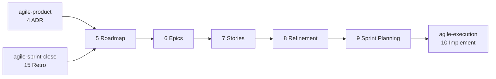

#  agile-planning

Planning: turns the approved product and architecture documents into a Roadmap, Jira Epics and Stories, a refined backlog and a launched sprint.

Part of [agile-skills](../README.md). Needs the Atlassian MCP (Confluence and Jira).

## What you get

| # | Skill | Produces | Say |
|---|---|---|---|
| 5 | `agile-5-roadmap` | Roadmap index, MVP and Iteration scope pages, a published Artifact view | "create the roadmap", "define MVP scope", "plan iterations" |
| 6 | `agile-6-create-epics` | Epics in Jira, linked to the MVP or Iteration page | "create epics", "break roadmap into epics" |
| 7 | `agile-7-create-stories` | User Stories in Jira under each Epic | "write stories", "create user stories" |
| 8 | `agile-8-refinement` | Points, ACs and DoD; `refined` / `not-ready` labels | "run refinement", "estimate stories", "story points" |
| 9 | `agile-9-sprint-planning` | A launched Jira sprint, capacity-fit and dependency-ordered | "plan the sprint", "start sprint", "assemble sprint" |



Refinement is the gate: only `refined` Stories enter a sprint; `not-ready` ones are listed and excluded. Sprint planning enforces a capacity buffer, dependency order and a testable sprint goal. Every skill is read-before-write, idempotent and resumable.

## Install

```bash
/plugin marketplace add cedricfarinazzo/agile-skills
/plugin install agile-planning@agile-skills
/reload-plugins
```

Run a skill as `/agile-planning:<skill>`. On Codex, run `codex plugin add agile-planning@agile-skills` and invoke `$<skill-name>`. Artifact publication is optional; record its absence and keep Confluence as the complete result. See the [compatibility guide](../docs/CODEX_COMPATIBILITY.md). Consumer configuration is read from `CLAUDE.md/AGENTS.md`, Claude first.

## The short-index Roadmap

`agile-5-roadmap` keeps the Roadmap page a **short index**: guiding principle, an iterations index table linking each child page, a one-row-per-sprint progress rollup, and a parking lot. All deep detail lives on child pages, `MVP — [Project]` and `Iteration N — [Project]`. Each carries an **Epic Sprint Plan** index table and one detail section per sprint (goal, decisions locked, backlog, scope, success criteria, conclusion, retro and closeout links). Never inline that detail into the Roadmap.

| Writer | Writes |
|---|---|
| `agile-9-sprint-planning` | Per-sprint backlog and Epic Sprint Plan row on the MVP or Iteration page; a one-row rollup on the index |
| `agile-8-refinement` | Refined-backlog detail in the relevant `## Sprint [N]` section, never the index |
| `agile-15-retro` | Flips the sprint section and index row to ✅ Complete; adds conclusion and retro links |

## The Roadmap Artifact

The Roadmap index is also published as a Claude Code Artifact: a private, shareable page for stakeholders without a Confluence seat, with the progress rollup as a velocity chart.

Confluence stays the source of truth; the artifact is regenerated from it. Its identity is a `📊 Live roadmap:` line on the Roadmap page holding the URL. Every refresher reads that URL and republishes to it, so the link stakeholders hold keeps working.

| Skill | Artifact action |
|---|---|
| `agile-5-roadmap` | Publishes when the Roadmap has no `📊 Live roadmap:` line, otherwise refreshes; writes the URL back on first publish |
| `agile-9-sprint-planning` | Refreshes after the sprint rollup row lands |
| `agile-15-retro` | Refreshes at sprint close, with delivered-vs-committed numbers |

The page is self-contained (a strict CSP blocks every external host), theme-aware and responsive, with a stable `🗺️` favicon across redeploys. Without the Artifact tool the step is skipped and noted.

## Confluence structure

Canonical folder layout, identical across every agile-skills plugin (embedded verbatim in each Confluence-using skill):

```
📁 [Project Name]                   (root — agile-1)
├── 📄 Vision Doc — [Project]       (agile-1)
├── 📄 PRD — [Project]              (agile-2)
├── 📄 Design Brief — [Project]     (agile-3 BRIEF)
├── 📄 Specs UI — [Project]         (agile-3 INTEGRATE)
├── 📄 ADR — [Project]              (agile-4)
├── 📄 Roadmap — [Project]          (agile-5 — SHORT INDEX only: guiding principle · iterations table · progress rollup · parking lot)
│   ├── 📄 MVP — [Project]          (agile-5; per-sprint detail by agile-9, refined backlog by agile-8)
│   ├── 📄 Iteration 1 — [Project]  (agile-5 ITERATION)
│   └── 📄 Iteration N — [Project]
├── 📁 Retrospectives — [Project]   (folder, agile-15; one Retro page per sprint)
└── 📁 Closeouts — [Project]        (folder, agile-13; sibling of Retrospectives, never inside it)
```

## Bundled tool: shared-file collision audit

`agile-8-refinement` bundles `scripts/sprint-shared-file-audit.sh`. It surfaces file overlap across Stories so blocking Jira links are added at refinement instead of rediscovered as merge conflicts. Invoke it through the plugin root, since a bare relative path does not resolve when installed:

```bash
"${CLAUDE_PLUGIN_ROOT}/skills/agile-8-refinement/scripts/sprint-shared-file-audit.sh" --text-dir <scratch> ABC-28 ABC-30 ABC-39
```

Usage: `skills/agile-8-refinement/docs/sprint-shared-file-audit.md`.

## Where it fits

After [agile-product](../agile-product/README.md), before [agile-execution](../agile-execution/README.md). Full cycle: [root README](../README.md#cycle-order).
