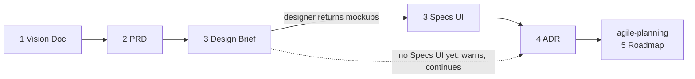

#  agile-product

Discovery: the *what and why*. Turns a raw idea into the approved Confluence documents everything downstream derives from.

Part of [agile-skills](../README.md). Needs the Atlassian MCP (Confluence; Jira is read for context).

## What you get

| # | Skill | Produces | Say |
|---|---|---|---|
| 1 | `agile-1-create-vision-doc` | Vision Doc and the project root folder | "new idea", "start project", "create vision doc" |
| 2 | `agile-2-create-prd` | PRD from the Vision Doc | "write PRD", "draft requirements" |
| 3 | `agile-3-design-brief` | Design Brief (BRIEF mode), then Specs UI (INTEGRATE mode) | "design brief", "UI specs", "integrate mockups" |
| 4 | `agile-4-create-adr` | ADR, tech feasibility and an Epic Breakdown Proposal | "write ADR", "architecture decisions", "assess tech" |



Each skill reads what the previous one wrote and asks you only for what is missing, in one message. It states every assumption and never drafts a section it has no information for.

## Install

```bash
/plugin marketplace add cedricfarinazzo/agile-skills
/plugin install agile-product@agile-skills
/reload-plugins
```

Run a skill as `/agile-product:<skill>`, or say one of its phrases. On Codex, run `codex plugin add agile-product@agile-skills` and invoke `$<skill-name>`; read the [compatibility guide](../docs/CODEX_COMPATIBILITY.md) before a run that writes to Confluence.

Each run is idempotent and resumable: re-running fills only what is missing and never duplicates a page.

## Two modes of `agile-3-design-brief`

| Mode | Writes | For |
|---|---|---|
| **BRIEF** | The brief that goes *to* the designer (Claude Design) | Before design |
| **INTEGRATE** | The designer's outputs, documented back as a Specs UI page | After design |

They are separate pages and never merged.

## Where the pages go

All four are children of the project root folder created by `agile-1`. The [canonical folder tree](../agile-planning/README.md#confluence-structure) is shared by every plugin. `agile-4` ends with an Epic Breakdown Proposal (section 11), the direct input to `agile-5-roadmap`. Each page ends with a `## Change history`; updates go there, not as inline notes. A decision taken after the first ADR gets an entry in the Decision Log (kept by `agile-5-roadmap`), and the ADR section cites its id.

## Where it fits

Cycle start. Hands off to [agile-planning](../agile-planning/README.md). Full cycle: [root README](../README.md#cycle-order).
