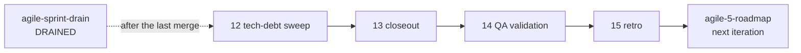

#  agile-sprint-close

Runs the end-of-sprint steps in order: housekeeping, a global engineering and product gate, post-merge QA sign-off, and the retrospective that feeds the next iteration.

Part of [agile-skills](../README.md). Needs `gh` and the Atlassian MCP (Confluence and Jira).

## What you get

Run in this order.

| # | Skill | What it does | Say |
|---|---|---|---|
| 12 | `agile-12-tech-debt-sweep` | Audits cross-repo leakage, useless CI, prebuild-image wins, `CLAUDE.md` / `AGENTS.md` / `SKILL.md` cruft, misplaced artifacts, dead code. Report before apply | "tech debt sweep", "cleanup sweep", "housekeeping", `/tech-debt-sweep` |
| 13 | `agile-13-sprint-closeout` | Mandatory epic-level gate through three lenses; publishes a report | "sprint closeout", "close sprint", `/sprint-closeout` |
| 14 | `agile-14-qa-validation` | Confirms acceptance criteria hold on `main` and stamps a sign-off | "validate story", "QA story", "QA check", "confirm ACs" |
| 15 | `agile-15-retro` | Retro page in Confluence, Roadmap update, refreshed Roadmap Artifact; feeds the next iteration | "run retro", "close sprint", "what did we learn" |



## Install

```bash
/plugin marketplace add cedricfarinazzo/agile-skills
/plugin install agile-sprint-close@agile-skills
/reload-plugins
```

On Codex, run `codex plugin add agile-sprint-close@agile-skills` and invoke `$<skill-name>`. Closeout phases and review lenses run sequentially inline, without subagents. Artifact publication is optional; Confluence stays the complete result. See the [compatibility guide](../docs/CODEX_COMPATIBILITY.md).

## Closeout: the third review layer

`agile-13-sprint-closeout` is a global, impartial gate on an epic's wired-together delivery against its goal (input: an epic key). The per-PR reviews ([author self-review](../agile-execution/README.md) and [independent merge review](../agile-merge-review/README.md)) already happened. Three lenses:

| Lens | Question |
|---|---|
| **Engineer** | Does the system work on a freshly rebuilt dev stack? (smoke and integration) |
| **Architect / PM** | Does delivered code match the documented intent (Vision, PRD, ADR, Roadmap, epic ACs)? |
| **Tech Lead** | Does it hold up under an impartial deep review of all sprint diffs? |

A single Critical from any lens blocks closeout. The report goes to the `Closeouts` Confluence folder, which the retro reads. It catches a sprint whose ACs pass individually but whose wired system fails. Phase 6.5 audits the merge train's Jira links with a bundled stdlib script (`skills/agile-13-sprint-closeout/scripts/audit_merge_train_links.py`; tests beside it, `python3 -m pytest` that dir).

## QA: confirm after merge

By the time `agile-14-qa-validation` runs, the Story is already Done; the [merge train](../agile-merge-review/README.md) owns that transition. QA confirms the ACs hold on `main` and stamps a sign-off comment. It never transitions the Story. A pass adds the `qa-approved` label and the sign-off comment. A post-merge regression is filed as a new Bug (linked `is caused by`, Story labelled `qa-regression`), never a reopen, because reversing Done would lose the merge audit trail.

## Retro and next iteration

`agile-15-retro` first answers every open question left in the sprint's Jira comments (from evidence, or with you through a question with options) and replies on each ticket. After the interview it puts each action item to you as a question with options (keep, turn into a ticket, merge, drop). It then writes the retro page in `Retrospectives`, reads the closeout report, closes the sprint's `Sprint N` page (properties, outcomes, conclusion) and its rows in the Iteration page and the Roadmap rollup (the Iterations table status flips only on the iteration's last sprint), adds standing rules to the Working Agreements and debt to the Debt Register, closes the sprint in Jira (carried-over Stories return to `To Do`; Won't Do Stories are confirmed with you), and hands velocity, feedback, debt and actions to `agile-5-roadmap` (ITERATION mode).

`Retrospectives` and `Closeouts` are sibling folders under the project root, never nested. See the [canonical folder tree](../agile-planning/README.md#confluence-structure).

## Where it fits

After [agile-merge-review](../agile-merge-review/README.md) (or [agile-sprint-drain](../agile-sprint-drain/README.md) reaching DRAINED); loops back to [agile-planning](../agile-planning/README.md). Full cycle: [root README](../README.md#cycle-order).
