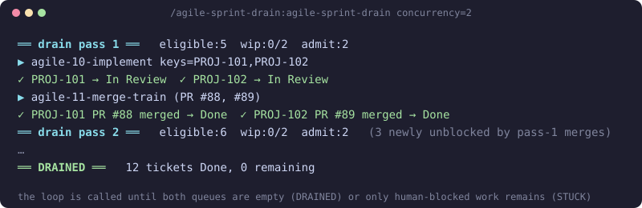

#  agile-sprint-drain

Runs the active sprint to the end in one watched session. It alternates the build queue ([agile-10-implement](../agile-execution/README.md)) and the merge queue ([agile-11-merge-train](../agile-merge-review/README.md)) until every ticket is Done and merged, or only human-blocked work is left. You watch; you no longer schedule.

Part of [agile-skills](../README.md). Needs the Atlassian MCP and `gh`, and **both** [agile-execution](../agile-execution/README.md) and [agile-merge-review](../agile-merge-review/README.md) installed.

## What you get

| Skill | What it does | Say |
|---|---|---|
| `agile-sprint-drain` | Loops build then merge, recomputed from the live board each pass, to a fixed point | "drain the sprint", "run the sprint to completion", "implement and merge until done", "clear the whole board", "ship the sprint" |

| Argument | Default | Effect |
|---|---|---|
| `concurrency=N` | `max-build-concurrency`, else `1` | WIP limit on the whole chain: tickets started but not merged, plus open PRs |
| `dispatch=phase\|session` | `phase` | `session` runs each pass in a build session and a fresh merge session ([Dispatch modes](docs/dispatch.md)) |
| `max-merges=N` | unbounded | Stop as PAUSED after N merges; re-invoke to continue |



Why it exists: a ticket blocked by another can be built only once the blocker is Done **and** its PR is merged. So each merge pass can unlock new build work, and someone has to alternate them. This skill is that scheduler.

## Install

```bash
/plugin marketplace add cedricfarinazzo/agile-skills
/plugin install agile-execution@agile-skills
/plugin install agile-merge-review@agile-skills
/plugin install agile-sprint-drain@agile-skills
/reload-plugins
```

Run `/agile-sprint-drain:agile-sprint-drain`. On Codex, run `$agile-sprint-drain`; everything runs inline and every `dispatch` value is treated as inline.

## How it ends

| End state | Meaning | You |
|---|---|---|
| **DRAINED** | All tickets Done and PRs merged, and the audit trail is complete. The only healthy stop | Run [agile-sprint-close](../agile-sprint-close/README.md) |
| **STUCK** | Every remaining item needs a person | Work the list it prints, then re-invoke |
| **PAUSED** | `max-merges` reached with work left | Re-invoke to continue from the ledger |

DRAINED and STUCK each send one push notification (`PushNotification`) at the top level. What STUCK reports and why a quiet pass is not a stop: [States](docs/states.md).

## Configuration

| Key | Default | Use |
|---|---|---|
| `session-batch` | `1` | Max tickets per `build-session` under `dispatch=session` |

Everything else is inherited from both orchestrators' `## Skill configuration` in the repo's `CLAUDE.md` or `AGENTS.md`: `cloudId`, status names, `base-branch`, `repo` / `repo-component-map`, lint and test commands.

Run state lives in `.git/agile-drain/` (`context.md`, `ledger.md`) and is never committed. For a long sprint, `/loop /agile-sprint-drain max-merges=N` runs each chunk in a fresh context.

## It does not

- Write Done, open PRs or merge. It sequences the two orchestrators, so every invariant they enforce holds.
- Bypass their pauses. A parked critical decision parks that one ticket and the rest keep going.
- Run [agile-sprint-close](../agile-sprint-close/README.md). On DRAINED it hands off.

## More

| Page | Covers |
|---|---|
| [States](docs/states.md) | The loop, the actionable-work guard, DRAINED / STUCK / PAUSED |
| [Dispatch modes](docs/dispatch.md) | `phase` vs `session`, the two session agents, the trade-off |
| [Reference](docs/reference.md) | Eligibility, merged signal, WIP limit, ledger, CI waits |

[agile-mods](../agile-mods/README.md) shows each drain pass, its cost and cache hit rate on a Drain tab.

## Where it fits

Between [agile-execution](../agile-execution/README.md) plus [agile-merge-review](../agile-merge-review/README.md), which it drives, and [agile-sprint-close](../agile-sprint-close/README.md), which it hands off to. Full cycle: [root README](../README.md#cycle-order).
