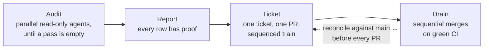

#  deep-refactor

Out-of-cycle cleanup in three skills that share one loop: audit deeply, prove every claim, ship the result as a sequenced PR train. Each skill freezes a different side of the repo as its proof.

Part of [agile-skills](../README.md). Needs `gh`, `git`, a CI you can query, and your tracker of choice. No Jira or Confluence required.

## What you get

| Skill | Changes | Frozen | Say |
|---|---|---|---|
| `deep-refactor` | Production code, codebase-wide | The test suite, as the contract | "deep refactor", "refactor audit", "clean the codebase", "DRY pass", "audit and fix everything" |
| `test-refactor` | One test suite at a time | Production code | "test refactor", "clean the tests", "refactor the tests", "test suite audit", "DRY the tests", "parallelize the test suite", "speed up the tests" |
| `test-refactor characterize <scope>` | Adds a minimal behavior test | Production code | "characterize before refactor", "characterization tests" |
| `doc-refactor` | Every markdown file (`.md`) | Source code | "doc refactor", "refactor the docs", "clean the docs", "documentation audit", "README audit", "docs are stale", "DRY the docs", "audit every markdown file" |
| `doc-refactor rules` | The standing instruction corpus | Source code | (a mode of `doc-refactor`) |



Every proposal carries its evidence (instrumented counts, mutation probes, real diffs, executed commands). Nothing merges without a self-verified green run.

## Install

```bash
/plugin marketplace add cedricfarinazzo/agile-skills
/plugin install deep-refactor@agile-skills
/reload-plugins
```

Run `/deep-refactor:deep-refactor`, `/deep-refactor:test-refactor` or `/deep-refactor:doc-refactor`. On Codex, install with `codex plugin add deep-refactor@agile-skills` and run `$deep-refactor`, `$test-refactor` or `$doc-refactor`; see the [compatibility guide](../docs/CODEX_COMPATIBILITY.md).

## Scope

- `deep-refactor` audits the whole codebase.
- `test-refactor` takes one suite at a time; you name it, for example "backend unit tests".
- `doc-refactor` inventories every markdown file.

Findings that can't be proven safe land on the report's blocked list, not in a PR. Recorded "deliberate: do not fix" decisions are not relitigated.

## More

| Page | Covers |
|---|---|
| [The loop](docs/loop.md) | Audit, report, ticket, drain, and the discipline of each |
| [deep-refactor](docs/deep-refactor.md) | Codebase audit with the tests frozen |
| [test-refactor](docs/test-refactor.md) | Per-suite test audit, characterize mode |
| [doc-refactor](docs/doc-refactor.md) | Markdown audit, rules mode |
| [Reference](docs/reference.md) | Non-vacuity proofs, per-file token diff, ticket order per skill |

## Where it fits

Independent of the product-to-sprint cycle; it needs no Jira or Confluence. See the [root README](../README.md).
