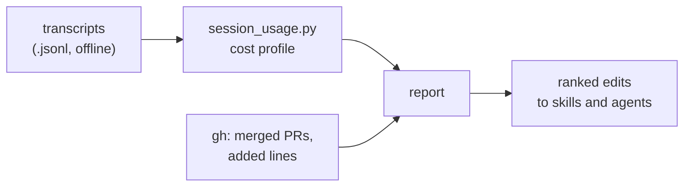

#  session-audit

Out-of-cycle, read-only audit of what a Claude Code session that ran agile-skills cost and what it shipped. It edits nothing; its output is a report.

Part of [agile-skills](../README.md). Needs `gh` in the repo to measure shipped work (optional); no Jira or Confluence.

## What you get

| Skill | What it does | Say |
|---|---|---|
| `session-audit` | Spend per skill and per subagent, a before/after comparison normalised by merged PRs and added lines, a check that the gates still held, and a ranked list of skill or agent edits that would cut spend | "audit this session's cost", "compare before and after sessions", "is the new version more efficient", "where do the tokens go", "subagent cost breakdown" |



## Install

```text
/plugin marketplace add cedricfarinazzo/agile-skills
/plugin install session-audit@agile-skills
```

For Codex (audits supplied Claude Code transcripts only; native Codex sessions are not supported):

```text
codex plugin marketplace add cedricfarinazzo/agile-skills
codex plugin add session-audit@agile-skills
```

Invoke it as `/session-audit:session-audit` in Claude Code or `$session-audit` in Codex.

## Bundled script

`skills/session-audit/scripts/session_usage.py` reads transcripts offline and prints the usage profile. It sends nothing anywhere.

```bash
python3 session_usage.py find <title-or-session-id>
python3 session_usage.py report --run before=a.jsonl --run after=b.jsonl,c.jsonl [--agents] [--price opus=<in>,<out>]
```

- A run may span several transcripts; messages shared by a resumed or forked session are counted once.
- Subagent transcripts are read from `<session>/subagents/` beside each file.
- `--shipped NAME=<merged PRs>,<added lines>` adds the efficiency table: cost and units per merged PR and per added line, with the gain between runs.
- Default prices are assumptions; pass `--price` for real ones.

Tests: `python3 -m pytest session-audit/skills/session-audit/scripts`.

## Without `gh`

The skill falls back to tickets moved to Done and says the measure is coarser.

## Where it fits

Out of cycle. Run it after a drain, an implement pass or a merge train, or to compare two plugin versions on similar work. It does not replace the [retro](../agile-sprint-close/README.md) or the sprint closeout. Full cycle: [root README](../README.md#cycle-order).
